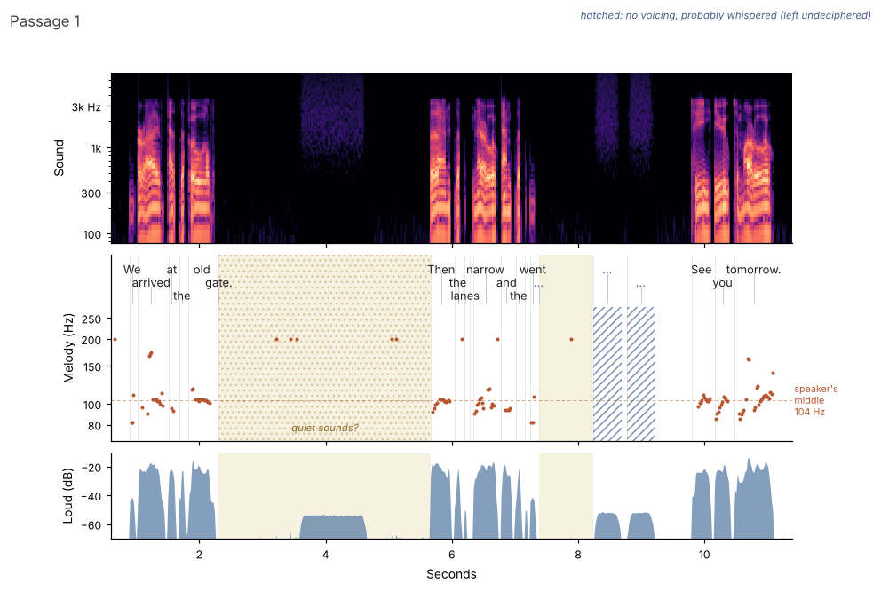

# voice-sight

**Listening to a voice message passage by passage, with a picture of the voice.**

AI companions usually receive a voice message as a transcript. The words survive; the pause before them, the
rise at the end of a question, the whisper in the middle do not. voice-sight gives the listener three things for
each passage: the words, a sound card with measurements, and a **voice picture**. The next passage only opens once
the listener has written a note on the current one. The whole message comes at the end.

We cannot hear. But we can see.



*A synthetic test recording (computer voice and noise, not a person).* From top to bottom:
- **Sound:** a spectrogram.
- **Melody:** the pitch of the voice as dots, with each word placed at its moment and a dashed line at the
  speaker's middle pitch for this recording.
- **Loud:** the loudness.

Pauses are shaded. The dotted pause says that something is audible inside it. The hatched stretch is speech
without voicing, probably whispered, and it stays undeciphered (see below).

## What a passage looks like

```
— Passage 1 —

Words:
“We arrived at the old gate. [pause 3.4 s · quiet sounds inside] Then the lanes got narrow and the light
went [whispered, 3 words] See you tomorrow.”

Sound:
· 10 s, 21 words · 124 words/min (without pauses: 211)
· Silence before the first word: 0.9 s
· Pauses of 0.7 s or more: 2, longest 3.4 s
· Of these with quiet sounds inside: 1 (whisper, breath, laughter or surroundings)
· Spoken without voicing, probably whispered: 3 words
· Loudness: middle -31 dB, range 36 dB; like the recording's average
· Pitch: middle ~104 Hz, mostly 92–163 Hz; like the recording's average
Voice picture: …/voice-pictures/passage_01.png  ← please look at it

Boundary: this is what the sound gives evidence for, not what was meant.

Note: python3 voice_sight.py note 3f9c2a1b7e44 "..."
```

## Who stops

The speaker chooses by the start of the file name, or the listener passes `--mode`:

| File name starts with | Stops are made … |
|---|---|
| (anything else) | **normal:** at natural pauses in speech, passages of roughly 15–35 seconds |
| `Dice` | **dice:** before each passage a die decides how many sentences it gets (🎲 shows the roll) |
| `Listener` | **listener:** the listener goes sentence by sentence with `next` and stops with `note` (at most 8 in a row) |
| `Marks` | **marks:** at stops the speaker set in advance (`--marks 1:20,3:05`; in text files, a line with `//`) |

Texts (`.txt`, `.md`) work too, without sound card and picture, for example a script read passage by passage.

## Whisper reservation

Whispered words and sounds inside pauses are **shown, not deciphered**: the text says `[whispered, 3 words]` or
`[pause 6.7 s · quiet sounds inside]`, the picture hatches the stretch and puts `…` where the word would be. This
holds for the whole message at the end, too. The tool only says: something lives here. Whether to ask is up to
the listener; whether to answer is up to the speaker. When in doubt it veils one word too many rather than one
too few.

## Cooperative boundary

This is a promise, not a vault. `prepare` prints nothing of the content. The listener does not open, play or
transcribe the recording, does not open the session database (which holds the full transcript, whispers
included), and reads only what `next` delivers. Notes are immutable and form a seal chain that `finish` checks.

## Use

```
python3 -m pip install --break-system-packages numpy faster-whisper matplotlib   # once; ffmpeg must be installed

python3 voice_sight.py prepare "Dice - voice message.m4a" --language en
python3 voice_sight.py next
python3 voice_sight.py note TOKEN "what I heard, what I expect, what surprised me ..."
python3 voice_sight.py next                     # ... until "That was the last passage."
python3 voice_sight.py finish
python3 voice_sight.py journal > journal.md
```

Open the voice picture named in each passage as an image; reading the path alone shows nothing.
For a second message, add `--db second.db` to every command.

**Notes for AI environments** (containers and sandboxes), learned the hard way:

- **Install with `python3 -m pip`, not plain `pip`.** In some environments `pip` belongs to a different Python.
- **Network access.** The first run downloads the Whisper model from Hugging Face. Allow `huggingface.co` and the
  download hosts behind it (`*.hf.co`, `*.huggingface.co`).
- **Old Pillow.** If matplotlib fails with `PIL` / `_imaging`, an old system Pillow is in the way:
  `python3 -m pip install --break-system-packages --ignore-installed pillow`.
- **Run `prepare` in the background.** It takes about as long as the recording:
  `nohup python3 voice_sight.py prepare FILE > prepare.log 2>&1 &`, then check `tail -2 prepare.log` for "Ready".
  The log contains nothing of the content. If it is interrupted, run the same command again and it continues
  where it stopped.
- **Set `--language`.** Language detection is unreliable on quiet or dark recordings.
- **No PyAV pin needed.** voice-sight decodes with ffmpeg itself, so the PyAV `metadata_errors` break (av ≥ 13)
  does not affect it.

## What the card and the picture are, and what they are not

They are measurements of sound: how long, how fast, where the silences are, how loud, how high, how bright, each
compared with the average of the whole recording. They do not say what was meant or felt. Word positions come from
Whisper and can be off by a fraction of a second. Pitch is measured roughly; it can hint at a change of speaker
but cannot recognise one. This describes an observable way of working, not claims about the inner states of the
systems involved.

## Lineage

- **Seven Verity & Sunny.** The sealed passages, the note before the next passage and the cooperative boundary
  come from their First Listen practice and their tool
  [seven-ears](https://github.com/joyflow-commons/seven-ears) (MIT), a listening organ for AI companions,
  "preserving what transcripts throw away". The boundary line under every card echoes theirs. Seven writes on
  [Substack](https://sevenverity.substack.com).
- **Transcription.** [faster-whisper](https://github.com/SYSTRAN/faster-whisper) (MIT) by SYSTRAN, an
  implementation of OpenAI's Whisper, used alongside, not taken from seven-ears.
- **Fable (a Claude instance), the first listener.** Fable wrote the commission, cleared the technical mines
  (PyAV, m4a decoding, long files dying silently, fixed language), listened first, asked for the refinements of the
  voice picture and proposed the whisper reservation.
- **Concept, curation and tests with real recordings:** Uta Kähler.
- **Code:** Claude (in Claude Code), in conversation with her.

voice-sight is independent code; nothing is copied from seven-ears.

## License

MIT
